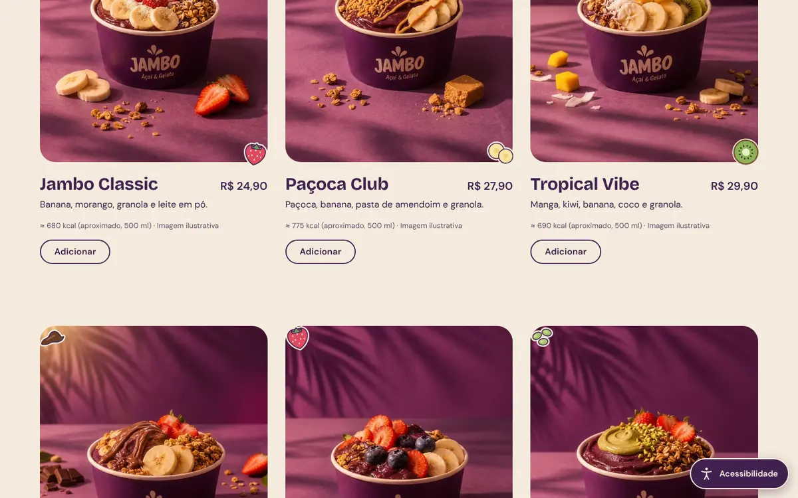
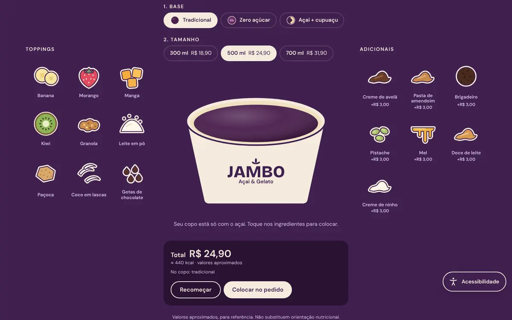

<div align="center">


# JAMBO — Açaí & Gelato

**Cardápio online com monte-seu-açaí e pedido pelo WhatsApp**

[**Ver o site**](https://let1ci4b.github.io/jambo/) &nbsp;·&nbsp; [Declaração de acessibilidade](https://let1ci4b.github.io/jambo/acessibilidade.html) &nbsp;·&nbsp; [Privacidade](https://let1ci4b.github.io/jambo/privacidade.html)


</div>

> [!NOTE]
> **Projeto de portfólio.** A JAMBO é uma marca fictícia. Preços, calorias, endereço e textos são inventados, e as fotos foram geradas por IA para a demonstração.

<br>

<p align="center">
  
</p>

## Sobre o projeto

| | |
|---|---|
| **Cliente** | JAMBO — Açaí & Gelato (fictício) |
| **Tipo** | Site-cardápio de página única, com pedido pelo WhatsApp |
| **Público** | Quem passa pelo Centro de Florianópolis querendo um açaí ou um gelato |
| **Versão** | 6 · novembro de 2026 |
| **Feito por** | [Letícia Beatriz](https://github.com/let1ci4b) |

## Destaques

- **Abertura animada.** O vídeo do açaí toca dentro das letras "JAMBO". Tem botão "Pular", e a abertura fica parada para quem prefere menos movimento.
- **Monte seu Jambo.** A pessoa arrasta os ingredientes para o copo (ou toca neles, no celular) e vê o preço e as calorias mudarem na hora. Também dá para montar por uma lista, sem arrastar.
- **Cardápio completo.** Açaí da casa, gelato, milkshakes, combos montáveis e bebidas.
- **Pedido pelo WhatsApp.** O carrinho monta uma mensagem organizada com os itens, o total e os dados do cliente.
- **Menu de acessibilidade.** Tamanho do texto, alto contraste, parar animações, fonte mais legível, mais espaço entre linhas e destaque de links. As escolhas ficam salvas no navegador.
- **Funciona sem JavaScript.** O cardápio já vem escrito no HTML, e o Google consegue ler tudo.
- **Card de compartilhamento e favicon.** O link aparece com imagem, título e descrição no WhatsApp, no Instagram e nas outras redes. O ícone funciona em todos os navegadores e na tela inicial do celular.

<table>
  <tr>
    <td width="50%"></td>
    <td width="50%"></td>
  </tr>
  <tr>
    <td align="center"><sub>Açaí da casa</sub></td>
    <td align="center"><sub>Monte seu Jambo</sub></td>
  </tr>
</table>

## Qualidade

| Teste | Resultado |
|---|---|
| Acessibilidade automática (axe-core, WCAG 2.2 AA), em 1440 px e 390 px | 0 violações |
| Validador de HTML (html-validate) | 0 erros |
| Lighthouse no celular | Desempenho 96 · Acessibilidade 100 · Boas práticas 100 |
| Peso da primeira carga | ~669 KB (o limite do projeto é 1,5 MB) |
| Texto aumentado para 160% no celular | sem rolagem para o lado |
| Teclado e leitor de tela | carrinho, montador e menus funcionam sem mouse |
| Movimento reduzido | abertura, fotos e vídeos ficam parados |

## Tecnologias

| | |
|---|---|
| **Base** | HTML, CSS e JavaScript, com [Vite](https://vite.dev) e sem framework |
| **Animações** | [GSAP](https://gsap.com) e three.js (copos 3D) |
| **Conteúdo** | arquivos JSON, que também podem ser editados pelo [Pages CMS](https://pagescms.org) |
| **Hospedagem** | GitHub Pages (demonstração) ou Cloudflare Pages |
| **Métricas** | Cloudflare Web Analytics, sem cookies |

## Rodar no computador

1. Instale o [Node.js 22](https://nodejs.org).
2. Na pasta do projeto, rode:

   ```sh
   npm install
   npm run dev
   ```

3. Abra http://localhost:5173.

Para ver a versão final, rode `npm run build` e depois `npm run preview` (http://localhost:4173).

## O que muda e onde

| O quê | Arquivo |
|---|---|
| Preços, nomes, descrições, calorias, "esgotado" | `content/cardapio.json` |
| Horário, endereço, WhatsApp, frase, endereço do site | `content/loja.json` |
| Texto e imagem do card de compartilhamento | `content/loja.json` e `public/assets/img/compartilhar.jpg` (1200 × 630) |
| Cores e fontes | `src/estilo.css` (bloco `:root`) |
| Fotos | `public/assets/img/` |
| Ícones do site (favicon) | `public/favicon.ico`, `public/assets/logo/` e `public/site.webmanifest` |
| Ingredientes (desenhos) | `public/assets/ingredientes/` |
| Abertura | `public/assets/js/abertura.js` e `public/assets/video/hero/` |
| Textos legais | `privacidade.html` e `acessibilidade.html` |

## Estrutura

```
├── index.html, privacidade.html, acessibilidade.html, 404.html   páginas
├── content/          dados do cardápio e da loja
├── src/              estilo e código (carrinho, montador, combos, acessibilidade)
├── public/           imagens, vídeos, fontes, ícones e modelos 3D
├── ferramentas/      monta o cardápio no build, gera a prévia e os arquivos de apoio
├── especificacao/    briefing, conceito, plano de imagens e regras do projeto
└── docs/             imagens deste README
```

## Publicar

- **GitHub Pages:** cada envio para a branch `main` publica o site sozinho, pelo arquivo `.github/workflows/pages.yml`.
- **Cloudflare Pages:** comando de build `npm run build`, pasta de saída `dist`, Node 22. Depois, troque o endereço em `content/loja.json`.

## Créditos

Design, código e conteúdo: **[Letícia Beatriz](https://github.com/let1ci4b)**, que faz sites simples e acessíveis para pequenos negócios.
Fontes: Bricolage Grotesque e DM Sans (SIL Open Font License).

<div align="center">
<sub>Feito com cuidado para funcionar para todo mundo.</sub>
</div>
