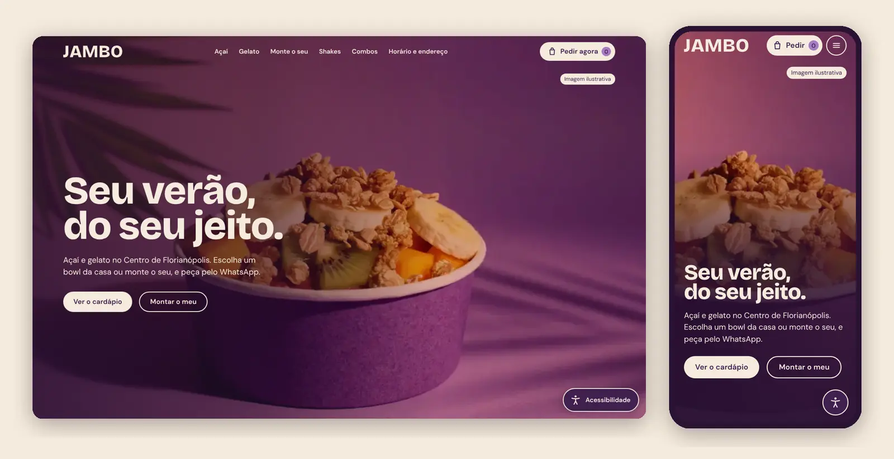

<div align="center">


# JAMBO — Açaí & Gelato

**Cardápio online com monte-seu-açaí e pedido pelo WhatsApp**

[**Ver o site**](https://jambo-3cc.pages.dev/) &nbsp;·&nbsp; [Declaração de acessibilidade](https://jambo-3cc.pages.dev/acessibilidade.html) &nbsp;·&nbsp; [Privacidade](https://jambo-3cc.pages.dev/privacidade.html) &nbsp;·&nbsp; [Termos, trocas e cancelamento](https://jambo-3cc.pages.dev/termos.html)


</div>

> [!NOTE]
> **Projeto de portfólio.** A JAMBO é uma marca fictícia. Preços, calorias, endereço e textos são inventados, e as fotos foram geradas por IA para a demonstração.

<br>

<p align="center">
  
</p>

## Sobre o projeto

| | |
|---|---|
| **Cliente** | JAMBO — Açaí & Gelato (fictício) |
| **Tipo** | Site-cardápio de página única, com pedido pelo WhatsApp |
| **Público** | Quem passa pelo Centro de Florianópolis querendo um açaí ou um gelato |
| **Versão** | 6 · novembro de 2026 |
| **Feito por** | [Letícia Beatriz](https://github.com/let1ci4b) |

## Destaques

- **Abertura animada.** O vídeo do açaí toca dentro das letras "JAMBO". Tem botão "Pular", e a abertura fica parada para quem prefere menos movimento.
- **Monte seu Jambo.** A pessoa arrasta os ingredientes para o copo (ou toca neles, no celular) e vê o preço e as calorias mudarem na hora. Também dá para montar por uma lista, sem arrastar.
- **Cardápio completo.** Açaí da casa, gelato, milkshakes, combos montáveis e bebidas.
- **Pedido pelo WhatsApp.** O carrinho monta uma mensagem organizada com os itens, o total e os dados do cliente.
- **Menu de acessibilidade.** Tamanho do texto, alto contraste, parar animações, fonte mais legível, mais espaço entre linhas e destaque de links. As escolhas ficam salvas no navegador.
- **Funciona sem JavaScript.** O cardápio já vem escrito no HTML, e o Google consegue ler tudo.
- **Card de compartilhamento e favicon.** O link aparece com imagem, título e descrição no WhatsApp, no Instagram e nas outras redes. O ícone funciona em todos os navegadores e na tela inicial do celular.

<table>
  <tr>
    <td width="50%"></td>
    <td width="50%"></td>
  </tr>
  <tr>
    <td align="center"><sub>Açaí da casa</sub></td>
    <td align="center"><sub>Monte seu Jambo</sub></td>
  </tr>
</table>

## Qualidade

| Teste | Resultado |
|---|---|
| Acessibilidade automática (axe-core, WCAG 2.2 AA), em 1440 px e 390 px | 0 violações |
| Validador de HTML (html-validate) | 0 erros |
| Lighthouse no celular | Desempenho 96 · Acessibilidade 100 · Boas práticas 100 |
| Peso da primeira carga | ~669 KB (o limite do projeto é 1,5 MB) |
| Texto aumentado para 160% no celular | sem rolagem para o lado |
| Teclado | carrinho, montador e menus funcionam sem mouse |
| Movimento reduzido | abertura, fotos e vídeos ficam parados |

## Tecnologias

| | |
|---|---|
| **Base** | HTML, CSS e JavaScript, com [Vite](https://vite.dev) e sem framework |
| **Animações** | [GSAP](https://gsap.com) e three.js (copos 3D) |
| **Conteúdo** | arquivos JSON, que também podem ser editados pelo [Pages CMS](https://pagescms.org) |
| **Hospedagem** | [Cloudflare Pages](https://pages.cloudflare.com), publicado a cada envio para a branch `main` |
| **Métricas** | Cloudflare Web Analytics, sem cookies |

## Rodar no computador

1. Instale o [Node.js 22](https://nodejs.org).
2. Na pasta do projeto, rode:

   ```sh
   npm install
   npm run dev
   ```

3. Abra http://localhost:5173.

Para ver a versão final, rode `npm run build` e depois `npm run preview` (http://localhost:4173).

## O que muda e onde

| O quê | Arquivo | Pelo editor? |
|---|---|---|
| Bowls, gelato, milkshakes, combos e bebidas (nome, descrição, preço, calorias, foto, "esgotado") | `content/cardapio/*.json` | Sim |
| Toppings e adicionais (um arquivo por ingrediente, com o desenho) | `content/ingredientes/*.json` + `public/assets/ingredientes/` | Sim |
| Regras do "Monte seu Jambo" (toppings inclusos, preço do extra, tamanhos) | `content/cardapio/montador.json` | Sim |
| Endereço, WhatsApp, Instagram, entrega, pagamento, horário, card de compartilhamento | `content/loja.json` | Sim |
| Textos das seções, botões, busca do Google, fotos da seção Visite | `content/textos.json` | Sim |
| Aviso "Imagem ilustrativa" | `content/loja.json` → `fotosIlustrativas` | Sim |
| Avisos de promoção (com datas) | `content/promocoes.json` | Sim |
| Preço promocional de bowls, milkshakes, combos e bebidas (com datas) | campos `precoPromo`, `promoInicio`, `promoFim` em `content/cardapio/*.json` | Sim |
| Cupons (o site confere e calcula; o código **não vai escrito** para o site) | `content/cupons.json` | Sim |
| Campo de cupom no pedido (ligar ou desligar) | `content/loja.json` → `aceitaCupom` | Sim |
| Imagem do card de compartilhamento | `public/assets/img/compartilhar.jpg` (1200 × 630) | Não |
| Logo, cores e fontes | `public/assets/logo/` e `src/estilo.css` (bloco `:root`) | Não (de propósito) |
| Abertura (vídeo) e vídeo do "Monte seu Jambo" | `public/assets/js/abertura.js`, `public/assets/video/` | Não (precisa gerar os quadros) |
| Copos 3D dos combos | `public/assets/3d/` | Não (saem das partes de cada combo) |
| Desenho das bases e do copo | `src/copo.js` | Não |
| Textos legais e o crédito do rodapé | `privacidade.html`, `termos.html`, `acessibilidade.html`, `index.html` | Não |

### Edição pelo Pages CMS

O dono edita em [app.pagescms.org](https://app.pagescms.org), configurado em `.pages.yml`. O menu do editor tem dois grupos:

- **Cardápio:** Açaí da casa · Ingredientes · Monte seu Jambo · Gelato · Milkshakes · Combos · Bebidas
- **Loja:** Dados, horário e pagamento · Textos da página

As listas fecham mostrando o nome e o preço de cada item. Os "Ingredientes que voam" de cada bowl são escolhidos numa lista com o nome dos ingredientes. Ingrediente novo pode ter um desenho próprio ou, sem desenho, um estilo (pedaços, salpicado, calda, creme) e uma cor. O site desenha o adesivo e o ingrediente dentro do copo. Foto nova vira webp e é cortada na proporção do lugar (sharp, no build).

### Promoções e cupons

- **Promoções:** cada aviso e cada preço promocional têm início e fim. O HTML sai no estado do dia da publicação, e `src/promocoes.js` confere de novo com a data do dia em Florianópolis assim que a página abre. Assim, uma promoção que acabou some sozinha, sem precisar publicar de novo, e o pedido sai com o preço certo (o item vai como "(promoção)" na mensagem).
- **Cupons:** cada cupom tem código, tipo (porcentagem ou valor fixo), desconto, pedido mínimo, validade e "ativo". No build, `ferramentas/cupons.mjs` gera o módulo `virtual:cupons` só com os cupons válidos, e cada código vira um hash SHA-256 (com o prefixo `jambo-cupom:`). O navegador calcula o hash do que o cliente digitou e compara. O carrinho mostra subtotal, desconto e total, e a mensagem do WhatsApp leva as três linhas. Cupom não reconhecido ou abaixo do mínimo vai na mensagem como "informado", sem desconto.
- **Travas dos cupons:** código fora do padrão, código repetido, sem tipo, sem valor ou porcentagem acima de 100 bloqueiam a publicação. O `vite.config.js` trava o build se `content/cupons.json` for importado ou se algum código ativo aparecer escrito no JavaScript ou no HTML publicado.
- **Limites (explicar ao cliente):** o hash esconde o código de quem olha o código do site, mas quem quiser pode testar palavras até acertar um código curto. O site também não sabe se o cliente já usou o cupom ("um uso por cliente" a loja confere). Use cupons para promoções divulgadas, não para descontos secretos grandes.
- **Atenção:** com o repositório **público**, qualquer pessoa vê os cupons no GitHub. Para um cliente de verdade, o repositório precisa ser **privado** (o Pages CMS e o Cloudflare funcionam igual).

### Travas para o site não cair

1. **No editor:** campos obrigatórios, tamanho máximo dos textos, preço mínimo e máximo, formato do WhatsApp, do Instagram e do horário, e número mínimo e máximo de itens.
2. **Antes de publicar:** `npm run build` roda `ferramentas/validar.mjs`. Ele confere tudo de novo, incluindo foto que não existe, ingrediente apagado, nome repetido, horário trocado e arquivo corrompido. Se houver erro, o build para, o Cloudflare não publica e **o site continua no ar com a versão anterior**. A mensagem diz onde está o problema e como resolver.
3. **Aviso:** a ação "Conferir conteúdo" (`.github/workflows/conferir-conteudo.yml`) roda a mesma conferência a cada mudança. Quando falha, o GitHub manda e-mail para quem salvou, e o resumo da execução mostra o que corrigir.
4. **No navegador:** `src/normalizar.js` arruma o que vier fora do padrão, e cada parte da página liga separada (`seguro()` em `src/main.js`). Assim, um erro numa parte não derruba as outras.

Rodar a conferência à mão: `npm run validar`.

**Atenção:** ao salvar, o Pages CMS apaga do JSON todo campo que não estiver no `.pages.yml`. Campo novo nos dados precisa entrar no `.pages.yml` e no `validar.mjs`.

## Estrutura

```
├── index.html, privacidade.html, termos.html, acessibilidade.html, 404.html   páginas
├── content/          dados do cardápio e da loja
├── src/              estilo e código (carrinho, montador, combos, acessibilidade)
├── public/           imagens, vídeos, fontes, ícones e modelos 3D
├── ferramentas/      monta o cardápio no build, gera a prévia e os arquivos de apoio
├── especificacao/    briefing, conceito, plano de imagens e regras do projeto
└── docs/             imagens deste README
```

## Publicar

- **Cloudflare Pages (oficial):** cada envio para a branch `main` publica o site em https://jambo-3cc.pages.dev/. Configuração: comando de build `npm run build`, pasta de saída `dist`, Node 22. Se o endereço mudar (domínio próprio), troque `site` em `content/loja.json`.
- **GitHub Pages (opcional):** cópia de reserva, acionada à mão em Actions → "Publicar no GitHub Pages" (precisa de Settings → Pages → Source: GitHub Actions).

## Créditos

Design, código e conteúdo: **[Letícia Beatriz](https://github.com/let1ci4b)**, que faz sites simples e acessíveis para pequenos negócios.
Fontes: Bricolage Grotesque e DM Sans (SIL Open Font License).

<div align="center">
<sub>Feito com cuidado para funcionar para todo mundo.</sub>
</div>
